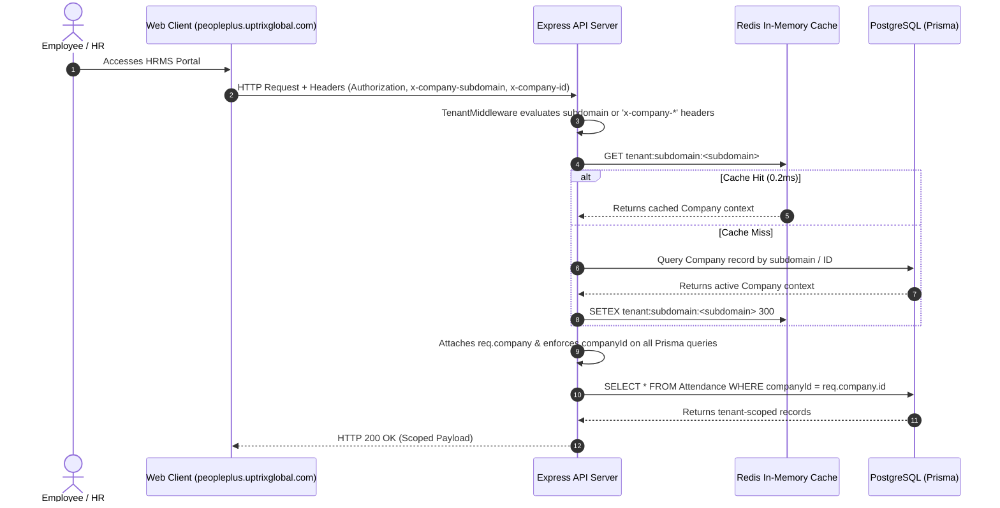
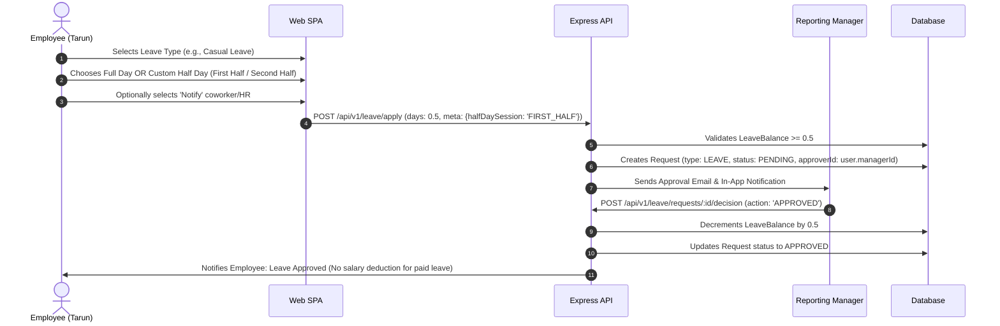
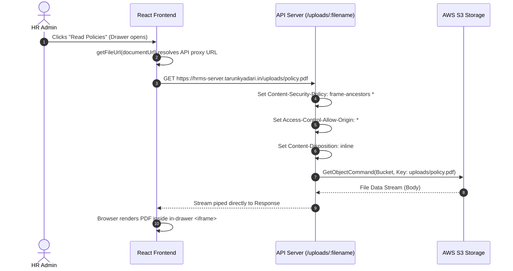
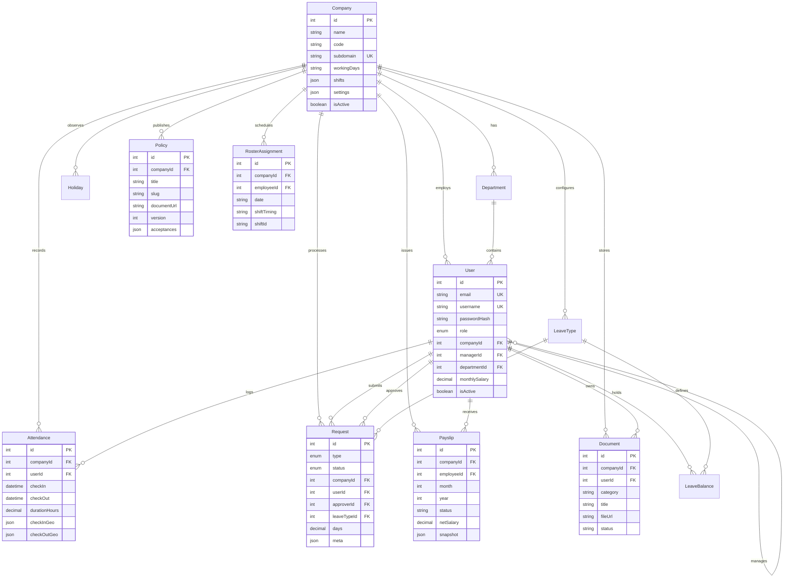

# System Architecture & Technical Design Document
## PeoplePlus / Uptrix HRMS Platform

> **Version:** 2.0  
> **Status:** Production Architecture  
> **Stack:** React 18 (Vite + TypeScript) | Node.js + Express (TypeScript) | PostgreSQL (Prisma ORM) | Redis (Cache & BullMQ) | AWS S3  

---

## 1. System Overview

**PeoplePlus (Uptrix HRMS)** is a cloud-native, multi-tenant Human Resource Management System (HRMS) designed for small to enterprise organizations. It streamlines the complete employee lifecycle—from onboarding and shift scheduling to daily attendance, leave approvals, corporate policy governance, compliance document verification, and payroll generation.

### Key Architectural Characteristics
- **Multi-Tenant with Shared Schema:** Single database instance with tenant partitioning by `companyId` for maximum resource efficiency and operational simplicity.
- **Decoupled Frontend & Backend:** React Vite Single Page Application (SPA) deployed across edge networks and an Express REST API backend hosted on dedicated application servers.
- **Direct Cloud Object Storage:** AWS S3 integration for compliance documents, employee KYC files, and policy PDFs with streaming proxy support.
- **Event-Driven Lifecycle:** Built-in cron automations for scheduled holiday alerts, shift roster assignments, and email notifications.

---

## 2. High-Level Architecture Diagram

```mermaid
flowchart TD
    subgraph Clients["Presentation Layer"]
        Browser["Desktop & Mobile Browsers (React 18 SPA)"]
    end

    subgraph Edge["Network & Edge Ingress"]
        DNS["DNS / SSL Edge (Cloudflare / Reverse Proxy)"]
    end

    subgraph Backend["Application Server (Node.js Express + TypeScript)"]
        IngressRouter["Express App Gateway (:5000 / :443)"]
        
        subgraph Middlewares["Security & Context Layer"]
            TenantMW["Tenant Resolution (Subdomain & Headers)"]
            AuthMW["JWT & RBAC Middleware"]
            CorsMW["CORS & Frame-Security Headers"]
        end
        
        subgraph DomainServices["Core Domain Engines"]
            AuthSvc["Auth & User Service"]
            AttendanceEngine["Attendance & Punch Engine"]
            RosterEngine["Shift & Roster Engine"]
            LeaveEngine["Leave & Approval Engine"]
            PolicyDocSvc["Policy & Document Streamer"]
            PayrollEngine["Payroll & Payslip Generator"]
            EmailScheduler["Event & Email Scheduler"]
        end

        subgraph BackgroundQueues["Background Processing (BullMQ)"]
            EmailWorker["Email Job Worker"]
        end
    end

    subgraph Persistence["Storage & External Infrastructure"]
        RedisCache[("Redis (In-Memory Cache & Queues)")]
        Postgres[("PostgreSQL Database (Prisma ORM)")]
        AWSS3[("AWS S3 Bucket (Documents & Images)")]
        SMTP["SMTP Mail Gateway (Nodemailer)"]
    end

    Browser -->|HTTPS REST API| DNS
    DNS -->|Proxy /api/v1| IngressRouter
    
    IngressRouter --> CorsMW
    CorsMW --> TenantMW
    TenantMW <-->|Fast Tenant Cache (0.2ms)| RedisCache
    TenantMW --> AuthMW
    AuthMW --> DomainServices

    AttendanceEngine --> Postgres
    RosterEngine --> Postgres
    LeaveEngine --> Postgres
    PayrollEngine --> Postgres
    AuthSvc --> Postgres

    EmailScheduler -->|Enqueues Job| RedisCache
    RedisCache -->|Pulls Job| EmailWorker
    EmailWorker --> SMTP
    EmailWorker --> Postgres

    PolicyDocSvc --> AWSS3
    PolicyDocSvc --> Postgres
```

---

## 3. Multi-Tenancy Architecture

The platform uses a **Shared Database, Shared Schema** multi-tenancy model. Every organization using the platform operates under an isolated logical tenant boundary.



### Multi-Tenancy Enforcement Rules:
1. **Resolution Priority:**
   - URL Subdomain (`tenant.domain.com` $\rightarrow$ `Company.subdomain`)
   - Explicit Headers: `x-company-subdomain` or `x-company-id` (useful for API clients & multi-domain routing)
2. **Data Partitioning:** Every primary database entity (`User`, `Attendance`, `Request`, `Document`, `Policy`, `Payslip`, `RosterAssignment`) contains a mandatory foreign key `companyId`.
3. **SuperAdmin Separation:** `Role.PRODUCT_SUPER_ADMIN` accounts exist independently of tenant companies to manage subscriptions, servers, and global billing plans.

---

## 4. Role-Based Access Control (RBAC)

The system employs a strict 6-tier Role hierarchy:

| Role | Scope | Key Permissions |
| :--- | :--- | :--- |
| **`PRODUCT_SUPER_ADMIN`** | Platform-wide | Provision new tenants, configure pricing packages, monitor server health, view platform billing. |
| **`COMPANY_ADMIN`** | Company Tenant | Full tenant access: working days, shifts, holidays, department creation, company policies, billing subscriptions. |
| **`HR`** | Operational HR | Employee onboarding, document verification, shift roster bulk assignments, leave approvals, official HR letters. |
| **`FINANCE`** | Payroll & Claims | Payslip generation, loan advances, expense claims, reimbursement settlements. |
| **`IT`** | Asset & Support | Hardware asset allocation, internal support ticket management, system infrastructure. |
| **`EMPLOYEE`** | Self Service | Check-in/out attendance, apply for full/half-day leave, view policies & sign, upload KYC documents, view payslips. |

---

## 5. Core Module Technical Workflows

### 5.1. Attendance & Shift Roster Engine
The attendance module bridges scheduled rosters with real-time employee punches to compute hours, late arrivals, half-days, and overtime.

```mermaid
flowchart TD
    Punch["Employee Punches (Web / Mobile GPS)"] --> CheckInValidation{"Active Shift Roster?"}
    
    CheckInValidation -->|Weekly Off (WO)| WO_Alert["Flagged as Weekly Off / Comp-Off eligible"]
    CheckInValidation -->|On Approved Leave| LV_Alert["Flagged: Employee is on Leave"]
    CheckInValidation -->|Regular Shift| CalcTime["Calculate Working Hours (CheckIn to CheckOut)"]
    
    CalcTime --> Threshold{"Duration Check"}
    Threshold -->|< 4.5 Hours| HalfDay["Half Day / Absent Flag"]
    Threshold -->|>= 4.5 & < 9 Hours| HalfDayWorked["Half-Day Credit (0.5d)"]
    Threshold -->|>= 9 Hours| FullDayWorked["Full-Day Credit (1.0d)"]
```

- **Roster Assignment (`RosterAssignment`):** Maps `(companyId, employeeId, date)` to specific shift timings or `Weekly Off` (`WO`).
- **Bulk Assignment Safeguard:** Bulk assignment preserves configured weekly offs (e.g. Sunday) to avoid overwriting non-working days.
- **Geo-Fencing:** Captures latitude, longitude, and device metadata in `checkInGeo` / `checkOutGeo` for audit compliance.

---

### 5.2. Leave Management & Half-Day Approval Engine
Handles comprehensive leave application, supervisor approval chains, and automated balance deduction.



- **Half-Day Logic:** Supports `0.5` day increments with explicit `FIRST_HALF` (morning) and `SECOND_HALF` (afternoon) session tags.
- **Approval Hierarchy:** Leaves are directed to the employee's direct `managerId`. If the employee has no manager, the request routes to HR/Company Admin.
- **Payroll Impact:**
  - **Paid Leave (CL/SL/PL):** Deducts from `LeaveBalance`; zero salary deduction.
  - **Loss of Pay (LOP / Unpaid):** Triggers `(monthlySalary / 30) * days` deduction during monthly payroll processing.

---

### 5.3. Policy & Document S3 Streaming Architecture
Documents (KYC IDs, educational proofs, corporate policies) are stored in AWS S3 and streamed through the API to prevent unauthorized public exposure and resolve cross-origin iframe security issues.



- **CORS & CSP Configuration:** Backend explicitly sets `Content-Security-Policy: frame-ancestors *` and removes `X-Frame-Options` on `/uploads/*` and `/image/*` routes, enabling secure in-app drawer embedding across subdomains.
- **Frontend Fallback Prevention:** Uses `getFileUrl` to prepend the production API server origin (`VITE_API_URL`), preventing the SPA web server from serving `index.html` (the Dashboard) inside file preview iframes.

---

### 5.4. Scheduled Email & Notification Engine
Background interval workers execute daily automation tasks:
1. **Upcoming Holiday Reminders:** Evaluates `Holiday` records and sends alert emails to employees **exactly 1 day prior** (`diffDays === 1`).
2. **Subscription Expiry:** Sends billing renewal warnings at 7 days, 3 days, and 1 day prior to `subEndDate`.
3. **Punch Reconciliation:** Identifies employees without check-in by mid-shift and alerts managers.

### 5.5. Real-Time Notification & Live Event Layer (Part 2)
Provides instant, sub-second push notifications to connected browsers without requiring page reloads or frequent HTTP polling:
- **Transport**: Server-Sent Events (SSE) via `GET /api/v1/notifications/stream`.
- **Clustering**: Dedicated Redis Pub/Sub channel (`hrms:realtime:events`) with in-memory local fallback.
- **Auto-Dispatch**: Prisma middleware automatically detects when any `Notification` record is created (leave applied, leave approved, ticket created) and broadcasts it immediately to the recipient's active browser session.

---

## 6. Database Entity-Relationship (ER) Model



---

## 7. Security & Compliance Architecture

| Layer | Implementation Mechanism |
| :--- | :--- |
| **Authentication** | JSON Web Tokens (JWT) signed with HMAC-SHA256, stored in `HttpOnly` Secure Cookies & Bearer headers. |
| **Password Storage** | Salted `bcrypt` hashing with work factor $\ge 10$. Temporary passwords forced to rotate on initial login. |
| **Tenant Isolation** | Scoped queries at the Prisma layer preventing cross-tenant data leaks. |
| **File Access Control** | Object uploads stored in private S3 buckets; downloads proxied through authenticated application streams. |
| **Embedding Security** | Granular CSP (`frame-ancestors *`) applied exclusively to preview endpoints, preventing unauthorized framing of administrative routes. |

---

## 8. Scalability & System Implementation Status

### Implemented Modules:
1. **Part 1 - Redis In-Memory Caching & Background BullMQ Queue:**
   - Multi-tenant company cache with $0.2\text{ms}$ resolution and auto-invalidation on updates.
   - BullMQ asynchronous queue for email notifications with retry backoff.
2. **Part 2 - Real-Time Live Push Notifications:**
   - Server-Sent Events (SSE) live push stream on `/api/v1/notifications/stream`.
   - Redis Pub/Sub cluster broadcast (`hrms:realtime:events`) with local fallback.
   - Instant in-app notification bell updates and browser desktop push without page refreshes.
3. **Part 3 - Enterprise Security, Rate Limiting & Diagnostic Telemetry:**
   - Distributed sliding-window rate limiters on `/auth/login` (15/15m) and `/attendance/check-in` (10/1m) with in-memory fallback.
   - Deep diagnostic endpoint `/health/system` monitoring PostgreSQL, Redis, AWS S3, and active real-time connections.
   - S3 direct presigned URL download route on `/documents/:id/presigned-url` (15-minute expiration).
4. **Part 4 - Enterprise Audit Trail, Traceability & Disaster Recovery:**
   - End-to-end request correlation IDs (`X-Request-Id`) across all HTTP requests and error responses for sub-second log debugging.
   - Append-only compliance audit trail (`logAudit`) capturing actor, IP, user-agent, and state diffs for critical HR operations.
   - Disaster recovery data snapshot utility (`createDisasterRecoverySnapshot`) verifying relational table integrity.

### Production Roadmap:
1. **CloudFront CDN Edge Caching:**
   - Route presigned S3 URLs through CloudFront edge distributions for global sub-100ms asset delivery.
2. **Read Replica Database Routing:**
   - Split heavy reporting and payslip analytics queries to a secondary read-only PostgreSQL replica.
