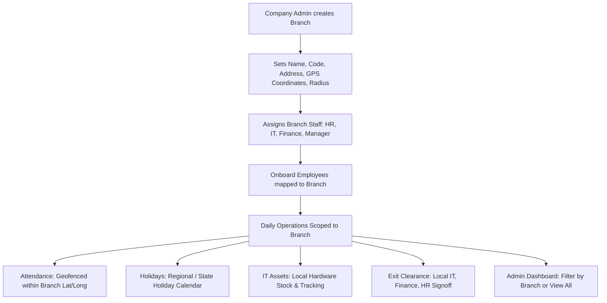

# Multi-Branch Architecture & Implementation Specification

## 1. Executive Summary

In this HRMS platform, a **Company** represents the top-level **Tenant** (e.g. *NovaTech Ltd.*), which holds a single billing subscription, domain/subdomain (`novatech.hrms.com`), and company-wide policies.

A **Branch** represents a physical or operational location under that company (e.g., *Bengaluru HQ*, *Mumbai Branch*, *Hyderabad Tech Center*, *Remote Hub*). 

Each branch operates with its own dedicated operational team:
- **Branch HR**: Manages local onboarding, attendance, local holidays, and documents.
- **Branch Manager**: Approves leaves, reviews performance, and manages team reports.
- **Branch IT**: Manages physical IT asset inventory and hardware onboarding at that branch.
- **Branch Finance**: Handles local expense claims, salary advances, and branch payout settlements.
- **Branch Employees**: Report to the branch, use geofenced attendance, and observe branch-specific holidays.
- **Company Admin (Executive / Head HR)**: Retains global visibility over **ALL branches**, with aggregate dashboards and a Branch Switcher.

---

## 2. Organizational Hierarchy & Role Scoping

```
                          ┌────────────────────────┐
                          │     COMPANY ADMIN      │
                          │   (Global CXO / HR)    │
                          │  Oversees ALL Branches │
                          └───────────┬────────────┘
                                      │
              ┌───────────────────────┴───────────────────────┐
              ▼                                               ▼
   ┌──────────────────────┐                       ┌──────────────────────┐
   │    BENGALURU HQ      │                       │    MUMBAI BRANCH     │
   │  (Branch Code: BLR)  │                       │  (Branch Code: MUM)  │
   ├──────────────────────┤                       ├──────────────────────┤
   │ • Branch HR          │                       │ • Branch HR          │
   │ • Branch Manager     │                       │ • Branch Manager     │
   │ • Branch IT          │                       │ • Branch IT          │
   │ • Branch Finance     │                       │ • Branch Finance     │
   │ • Branch Employees   │                       │ • Branch Employees   │
   └──────────────────────┘                       └──────────────────────┘
```

### Role Visibility & Access Matrix

| Role | Branch-Level Scope (e.g., Mumbai) | Company Admin Scope (Global) |
| :--- | :--- | :--- |
| **Branch HR** | Only views/manages Mumbai branch employees, attendance logs, leave approvals, and document reviews. | Central HR creates global policy templates and oversees all branch HRs. |
| **Branch Manager** | Approves leave/claims and views goals for reporting employees at Mumbai. | Views organization chart across all branches. |
| **Branch IT** | Manages hardware asset inventory (laptops, monitors) physically at Mumbai; performs IT onboarding checklists. | Central IT infrastructure, domain, and server deployments. |
| **Branch Finance** | Reviews branch-specific expense claims, local salary advances, and exit settlements. | Corporate billing, subscription packages, and company-wide finance analytics. |
| **Branch Employee** | Check-in geofenced to Mumbai GPS coordinates; reports to Mumbai manager; sees Mumbai state holidays. | — |

---

## 3. End-to-End Operational Workflow



### Step 1: Branch Setup & Configuration
1. Company Admin navigates to `HR Operations > Branches` (`/company/branches`).
2. Creates a branch with:
   - **Branch Name**: e.g., *Mumbai Regional Office*
   - **Branch Code**: e.g., *MUM-01*
   - **Contact Email & Phone**: Branch contact information
   - **Complete Address**: Street, City, State, Country, Postal Code
   - **Timezone**: e.g., `Asia/Kolkata`
   - **Geolocation & Geofence**: Latitude, Longitude, and Allowed Radius (e.g., `200 meters`)
   - **Branch Head / SPOC**: Selected from existing managers
   - **Main Branch Flag**: Marks the corporate headquarters

### Step 2: Staff & Employee Assignment
1. When adding or editing an employee (`NewEmployeePage.tsx` or `BulkEmployeeImport.tsx`):
   - Select **Role**: `HR`, `FINANCE`, `IT`, or `EMPLOYEE`
   - Select **Branch**: `Mumbai Regional Office`
2. The user's `branchId` is saved, linking them permanently to that branch.
3. Their work address is auto-populated from the branch's physical address.

### Step 3: Automated Daily Operations
- **Geofenced Check-In**:
  When an employee clicks "Check In" (WFO mode), the system uses the Haversine formula to verify if their GPS coordinates fall within `radiusMeters` of their assigned branch.
- **Branch-Specific Holidays**:
  Holidays can be marked as `All Branches` (National) or tagged to a specific `branchId` (State/Regional).
- **Asset Allocation**:
  IT assets (laptops, monitors) are tagged with `branchId`, ensuring hardware inventory is accurate per office.
- **Exit NOC Clearance**:
  When an employee resigns, the NOC clearance checklist routes to their specific Branch IT, Branch Finance, and Branch HR.

### Step 4: Global Branch Switcher
Company Admins have an active **Branch Switcher** in the top navigation header:
```
[ 📍 All Branches ▼ ]
  ✓ All Branches (Aggregated view)
  • Bengaluru HQ (85 Employees)
  • Mumbai Branch (42 Employees)
  • Hyderabad Branch (30 Employees)
```
Selecting a branch filters all dashboards, employee rosters, attendance statistics, and payroll reports to that specific branch.

---

## 4. Database Schema Changes (`apps/api/prisma/schema.prisma`)

### A. New `Branch` Model
```prisma
model Branch {
  id              Int            @id @default(autoincrement())
  companyId       Int
  company         Company        @relation(fields: [companyId], references: [id], onDelete: Cascade)
  
  name            String         // e.g. "Mumbai Regional Office"
  code            String         // e.g. "MUM-01"
  email           String?
  phone           String?
  address         String         // Street address
  city            String         @default("")
  state           String         @default("")
  country         String         @default("India")
  postalCode      String         @default("")
  timezone        String         @default("Asia/Kolkata")

  // Geofencing for Attendance Check-In
  latitude        Decimal?       @db.Decimal(10, 7)
  longitude       Decimal?       @db.Decimal(10, 7)
  radiusMeters    Int            @default(200)

  // Branch Head / SPOC
  branchHeadId    Int?
  branchHead      User?          @relation("BranchHead", fields: [branchHeadId], references: [id], onDelete: SetNull)

  isMainBranch    Boolean        @default(false)
  isActive        Boolean        @default(true)

  createdAt       DateTime       @default(now())
  updatedAt       DateTime       @updatedAt

  users           User[]         @relation("BranchUsers")
  holidays        Holiday[]      @relation("BranchHolidays")
  assets          CompanyAsset[] @relation("BranchAssets")

  @@unique([companyId, code])
  @@unique([companyId, name])
  @@index([companyId, isActive])
}
```

### B. Updates to `User` Model
```prisma
model User {
  ...
  companyId             Int?
  company               Company?    @relation(fields: [companyId], references: [id], onDelete: Cascade)
  
  // Branch mapping
  branchId              Int?
  branch                Branch?     @relation("BranchUsers", fields: [branchId], references: [id], onDelete: SetNull)
  branchesLed           Branch[]    @relation("BranchHead")

  // Allows Central HR/Finance to access all branches
  canManageAllBranches  Boolean     @default(false)
  ...
  @@index([companyId, branchId])
}
```

### C. Updates to `Company`, `Holiday`, and `CompanyAsset`
- In `model Company`: Add `branches Branch[]`
- In `model Holiday`: Add `branchId Int?` and `branch Branch? @relation("BranchHolidays", fields: [branchId], references: [id], onDelete: Cascade)` (null means All Branches)
- In `model CompanyAsset`: Add `branchId Int?` and `branch Branch? @relation("BranchAssets", fields: [branchId], references: [id], onDelete: SetNull)`

---

## 5. Backend API Specifications (`apps/api`)

### Branch CRUD Endpoints (`/company/branches`)

| Method | Endpoint | Allowed Roles | Description |
| :--- | :--- | :--- | :--- |
| `GET` | `/company/branches` | All Authenticated | Returns branches list with counts of active employees and branch head details. |
| `POST` | `/company/branches` | `COMPANY_ADMIN`, `HR` | Creates a new branch (validates unique name & code). |
| `GET` | `/company/branches/:id` | All Authenticated | Gets details of a specific branch. |
| `PATCH` | `/company/branches/:id` | `COMPANY_ADMIN`, `HR` | Updates branch details (address, geofence, head, status). |
| `DELETE` | `/company/branches/:id` | `COMPANY_ADMIN` | Deactivates or removes branch (blocks deletion if active employees are assigned). |

### Automatic Query Scoping Middleware
```typescript
// Example scoping pattern for routes (e.g. /employees, /attendance, /assets):
export function applyBranchScope(req: Request, whereClause: any) {
  const user = req.user!;
  
  if (user.role === 'COMPANY_ADMIN' || user.canManageAllBranches) {
    // Admin / Global Staff can optionally filter by branch or view all
    if (req.query.branchId) {
      whereClause.branchId = Number(req.query.branchId);
    }
  } else {
    // Branch HR / IT / Finance / Manager are scoped to their branch
    if (user.branchId) {
      whereClause.branchId = user.branchId;
    }
  }
  return whereClause;
}
```

### Geofencing Attendance Check
```typescript
// Haversine formula calculation in attendance check-in:
function isWithinRadius(userLat: number, userLng: number, branchLat: number, branchLng: number, radiusMeters: number): boolean {
  const R = 6371e3; // Earth radius in meters
  const dLat = ((branchLat - userLat) * Math.PI) / 180;
  const dLng = ((branchLng - userLng) * Math.PI) / 180;
  const a =
    Math.sin(dLat / 2) * Math.sin(dLat / 2) +
    Math.cos((userLat * Math.PI) / 180) *
      Math.cos((branchLat * Math.PI) / 180) *
      Math.sin(dLng / 2) * Math.sin(dLng / 2);
  const c = 2 * Math.atan2(Math.sqrt(a), Math.sqrt(1 - a));
  const distance = R * c;
  return distance <= radiusMeters;
}
```

---

## 6. Frontend UI Specifications (`apps/web`)

1. **Branches Management Page (`apps/web/src/pages/company/BranchesPage.tsx`)**:
   - Modern cards/table view displaying:
     - Branch Name & Code badge
     - Location (City, State, Country)
     - Branch Head name and avatar
     - Active Employee headcount
     - Geofence status (Coordinates & radius)
     - Primary / Main HQ badge
   - "Add Branch" & "Edit Branch" slide-over or modal with geofence settings.

2. **Sidebar Navigation (`apps/web/src/components/layout/Sidebar.tsx`)**:
   - Add **Branches** under `HR Operations` (above or below `Departments`).

3. **Employee Onboarding (`apps/web/src/pages/company/NewEmployeePage.tsx`)**:
   - Add Branch selection dropdown in the Organization details section.
   - Bulk import template updated with a `Branch Code` column.

4. **Employee Directory (`apps/web/src/pages/company/EmployeesPage.tsx`)**:
   - Add Branch filter pill / dropdown.
   - Employee cards/rows display branch badge.

5. **Header Branch Switcher (`apps/web/src/components/layout/Header.tsx` or `AppLayout.tsx`)**:
   - Dropdown for Company Admin to toggle views between "All Branches" and specific branches.
   - Fixed location badge for branch staff (e.g. `📍 Mumbai Branch`).

---

## 7. Phased Implementation Roadmap

- [ ] **Phase 1: Database Migration**
  - Add `Branch` model to `schema.prisma`.
  - Add `branchId` to `User`, `Holiday`, and `CompanyAsset`.
  - Generate Prisma client and run migration.
- [ ] **Phase 2: Backend API & Service Logic**
  - Create `apps/api/src/routes/branches.ts` with full CRUD.
  - Update `employees.ts` to accept `branchId` during create, update, and bulk Excel import.
  - Implement branch scoping logic in employee, attendance, and asset queries.
  - Implement geofence validation in `/attendance/check-in`.
- [ ] **Phase 3: Frontend Branch Management**
  - Create `BranchesPage.tsx`.
  - Register route `/company/branches` in `App.tsx`.
  - Add "Branches" link to `Sidebar.tsx`.
- [ ] **Phase 4: Employee Onboarding & Directory Integration**
  - Add Branch selector to `NewEmployeePage.tsx`.
  - Add Branch filter to `EmployeesPage.tsx`.
  - Update `BulkEmployeeImport.tsx` template and parser.
- [ ] **Phase 5: Global Header Switcher & Super Admin Polish**
  - Add Branch Switcher dropdown in header layout.
  - Dynamically populate `locationsCount` in Super Admin `CompaniesPage.tsx`.
